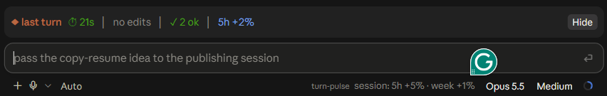
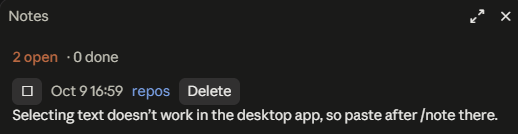
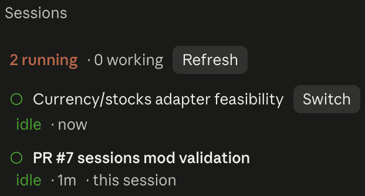
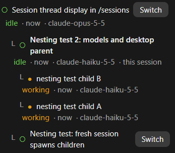

# claude-code-mods

Small mods for [Claude Code](https://claude.com/claude-code), built on its function-hooks plugin API.

| Mod | What it does |
| --- | --- |
| [turn-pulse](plugins/turn-pulse) | A status line summarizing the last turn, live while Claude works, with an optional band above the prompt. |
| [notes](plugins/notes) | `/note` saves chat text to a notes list shared across projects; `/notes` opens it in a side pane. |
| [sessions](plugins/sessions) | `/sessions` opens a side pane listing the sessions running on this machine and whether each is working or idle. |

> **Early access.** The mod API these use is marked EARLY ACCESS and may change between Claude Code releases. Built and tested on Claude Code 2.1.293, on Windows, in the desktop app's Code tab.

## Install

In a terminal, add the marketplace once:

```
claude plugin marketplace add ilya-paskhover/claude-code-mods
```

Then install one line per mod:

```
claude plugin install turn-pulse@claude-code-mods
```

```
claude plugin install notes@claude-code-mods
```

```
claude plugin install sessions@claude-code-mods
```

This installs in the user scope, so the mod loads in every new session, including sessions the desktop app starts. Inside an interactive `claude` session, `/plugin marketplace add` and `/plugin install` take the same arguments. `/plugin` is not available inside the desktop app's Code tab, so install from a terminal.

## turn-pulse

Between turns the status line shows the last turn and the session's spend:

```
last turn 35s · no edits · 3 ok · session: 5h +2% · week +0%
```

- **Duration** of the turn.
- **Files edited**: the first 3, then `+N`. An edit **outside the session's working folder** shows as `⚠ outside: name`, with a 15 second toast.
- **Tool results**: `N ok`, and `N failed (Tool ×n)` when something failed.
- **Usage-limit spend** of the session so far.

During a turn the status line shows `▶ Tool · N ok · ✗ N failed` live. A toast appears when a turn takes 60 seconds or more.

The band above the prompt is optional and off by default, so it leaves the slot to other mods:



- `/pulse band on` or `/pulse band off` sets it, and `/pulse band` switches it. The band's **Hide** button also turns it off. The choice is kept across sessions and projects.
- The band labels the row **◆ last turn** and shows the same parts in color, with the **turn's** usage-limit cost rather than the session's. The duration turns yellow past 2 minutes.
- When on, it shares the slot: another mod's band draws below it.

`/pulse` says whether the band is on. In a cloud session `/pulse` prints the last turn and the session total as text instead, since the Claude app showing the session may not draw the band or the status line.

Limits:

- Usage numbers are account-wide, so other sessions running at the same time count toward them.
- Tracking starts when the mod loads, and the handling of a limit window resetting is heuristic.
- Paths are compared case-insensitively. That is right on Windows but could misjudge an "outside" edit on a case-sensitive Linux file system.

## notes



- `/note <text>` saves the typed text. With text selected in the transcript, `/note <comment>` saves the selection with the typed text as its comment.
- Notes are kept in the mod's own store, shared across all sessions and projects.
- `/notes` opens a **Notes** side pane: notes render as Markdown, long ones fold behind More/Less, and each has a ☐/☑ done toggle, Delete, and Jump (scroll to the message it came from; same session only). Show/Hide done and Clear done act on the whole list.
- Text pasted into the prompt has its `<pasted_content>` wrapper stripped.

Limits:

- In the desktop app the selection is not passed to mods, so `/note` there needs pasted or typed text, and Jump never appears. Selection is documented to work in the fullscreen terminal; I have not verified that. Tracked in [#1](https://github.com/ilya-paskhover/claude-code-mods/issues/1).
- Jump only scrolls within the session the note was taken in; mods can't open another session. Tracked in [#4](https://github.com/ilya-paskhover/claude-code-mods/issues/4).

## sessions





`/sessions` opens a **Sessions** side pane listing every Claude Code session running on this machine, from any folder:

- A count of running and working sessions, and a Refresh button.
- One row per session: ● **working** (yellow) or ○ **idle** (green), the session's name, how long since its last activity, and "this session" on your own row.
- A **Switch** button on each session the desktop app started opens that session in the app. Sessions started in a terminal have no button.
- Working sessions sort first, then the most recently active.
- A session spawned by another one, such as a `claude -p` run started from a Bash call or a session started from another in the desktop app, shows indented under its parent (local sessions only).
- Each local session's row names the model it runs on, once its desktop file or transcript says.
- The pane refreshes every 5 seconds while it is open and stops when you close it.
- The pane opens by itself once per local session: at start in a terminal, or when the desktop app connects. It opens unfocused, so the prompt keeps the keyboard. Close it and it stays closed for that session, through reloads and desktop reconnects.

In a cloud session, where the container holds only that one session, `/sessions` lists your 10 most recent cloud sessions instead, from the `claude-code-remote` MCP server every cloud session has:

- ● **working**, ◐ **needs input** with what the session is waiting on, ✗ **failed**, or ○ **idle** (finished or ready for review).
- An **Open** link on each other session goes to its page on claude.ai.
- The pane refreshes every 30 seconds, since each refresh is an API call.

Limits:

- Opened by itself, the pane shows only in a window at least 144 columns wide, or 110 once you have opened it with `/sessions`. In a narrower one it waits until you run `/sessions`. Cloud sessions don't open it by themselves, since each refresh there is an API call; `/sessions` opens it.
- The list comes from Claude Code's own files in `~/.claude/sessions/` (or `$CLAUDE_CONFIG_DIR/sessions/`), not from the mod API. That format is undocumented and could change in any release; if no file can be read, the pane says so instead of showing a wrong list.
- Locally, only sessions running on this machine appear: closed sessions and cloud sessions do not. In a cloud session, only cloud sessions appear, not the ones on your computer.
- The cloud list is the `claude-code-remote` server's `list_sessions` output, which is not a documented format either; if it can't be read, the pane says so. In a live cloud session the plugin loads and `/sessions` runs, but the pane does not appear; tracked in [#14](https://github.com/ilya-paskhover/claude-code-mods/issues/14).
- Nesting comes from the process table, since session files don't name a parent, and from the desktop app's own session files for sessions it started. Those files, like the transcripts the model name comes from for other sessions, are not mod API and could change in any release; the pane then shows no model or a flatter list. A model read from a transcript is kept for that session's life, so a later `/model` doesn't show. The pane opens before those are read, so a new session's parent and model can appear a moment later. A child whose parent has exited goes back to top-level. If the process table can't be read, the list stays flat and the pane tries again after 5 seconds, then less often, down to once a minute.
- Switch works only for sessions the desktop app started, through an undocumented `claude://` link, not a mod API (tracked in [#4](https://github.com/ilya-paskhover/claude-code-mods/issues/4)).
- In the desktop app, a click on the pane first gives it focus, so a button may need two clicks: one to focus the pane, one to press. The pane opens focused, so the first click right after `/sessions` works; after you click elsewhere, click anywhere in the pane (or Refresh) first. Press Esc to give the keyboard back to the prompt.
- Sessions and Notes open as tabs in the same side pane; mod panes can't be shown side by side. Tracked in [#5](https://github.com/ilya-paskhover/claude-code-mods/issues/5).
- A session that crashed can leave its file behind. The session file only changes when the status changes, so a "working" row shows dimmed as "working?" once it has been busy for 30 minutes: either a long turn or a crash. The pane can't tell which.

## Developing

Each mod is a plugin folder under `plugins/`. To run a working copy instead of the installed one, name the folders in the `env` block of `~/.claude/settings.json` (separated by `;` on Windows, `:` elsewhere) and uninstall the marketplace copy so the mod does not load twice:

```json
{
  "env": {
    "CLAUDE_CODE_PLUGIN_DIRS": "/path/to/claude-code-mods/plugins/turn-pulse;/path/to/claude-code-mods/plugins/notes"
  }
}
```

Interactive sessions watch those folders and reload a mod when its files are saved. Checks, per mod folder:

```
claude plugin validate plugins/notes
```

```
claude plugin test plugins/notes
```

To try a branch's copy of a mod in a cloud session, add these lines to the cloud environment's setup script, set `BRANCH` and `MOD`, then start a new session. They copy the mod into a one-mod marketplace and install it from there:

```sh
BRANCH=claude/my-branch
MOD=sessions
git clone --depth 1 -b "$BRANCH" https://github.com/ilya-paskhover/claude-code-mods /tmp/mod-branch
M=/tmp/mod-branch-mkt
mkdir -p $M/.claude-plugin $M/plugins
cp -r /tmp/mod-branch/plugins/$MOD $M/plugins/
cat > $M/.claude-plugin/marketplace.json <<EOF
{"name":"mod-branch","owner":{"name":"Ilya Paskhover"},"plugins":[{"name":"$MOD","source":"./plugins/$MOD"}]}
EOF
claude plugin marketplace add $M && claude plugin install $MOD@mod-branch
```

In the session, `claude plugin list` should then show `<mod>@mod-branch` enabled.

Each mod's `tsconfig.json` extends the type declarations the engine writes into `.claude-plugin/types/` when it loads the mod (gitignored), so `tsc -p plugins/notes` works once the mod has loaded once.

### Releases

Bump `version` in a mod's `.claude-plugin/plugin.json` and merge to `main`: a workflow creates the release, tagged `<mod>-v<version>`, with the commits that touched that mod as its notes. See [`release.sh`](.github/scripts/release.sh). Run it with `DRY_RUN=1` to see what it would create. Installs don't depend on releases: the marketplace reads `plugin.json` from the repository.

### Reviewing a PR

`.claude/settings.json` enables two review plugins for every session in this repo, cloud sessions included, so Claude Code asks once to trust their marketplaces: Addy Osmani's [`agent-skills`](https://github.com/addyosmani/agent-skills) and Anthropic's [`pr-review-toolkit`](https://github.com/anthropics/claude-plugins-official/tree/main/plugins/pr-review-toolkit).

1. Run `/agent-skills:code-review-and-quality` first: one agent, one report, few false alarms.
2. For a risky PR, add `/pr-review-toolkit:review-pr errors tests`, which finds what the first one misses about error handling and tests. Add `comments` or `types` when those changed; `all` runs every agent.

On [#16](https://github.com/ilya-paskhover/claude-code-mods/pull/16) the two together found every issue, and neither did alone (see the comparison comments there and on [#12](https://github.com/ilya-paskhover/claude-code-mods/pull/12)).

## License

[MIT](LICENSE)
